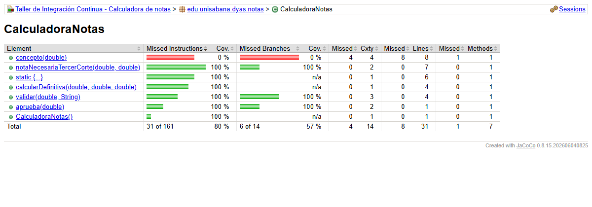
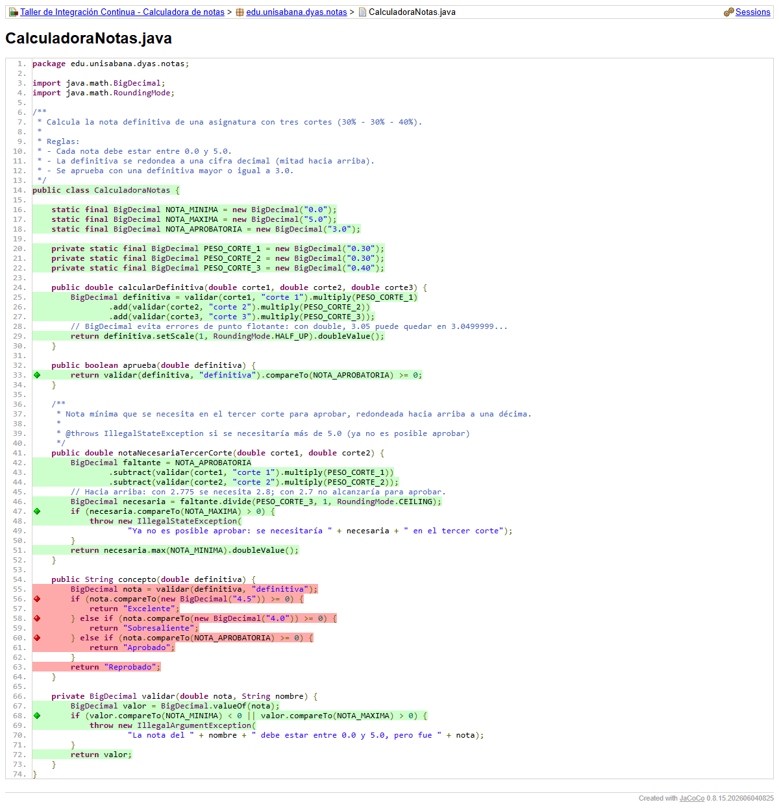
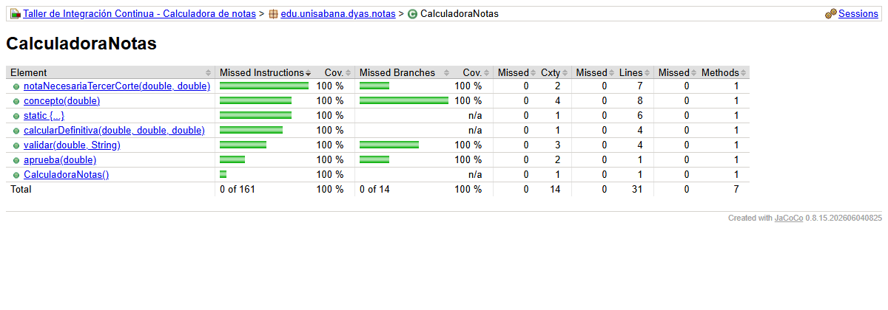
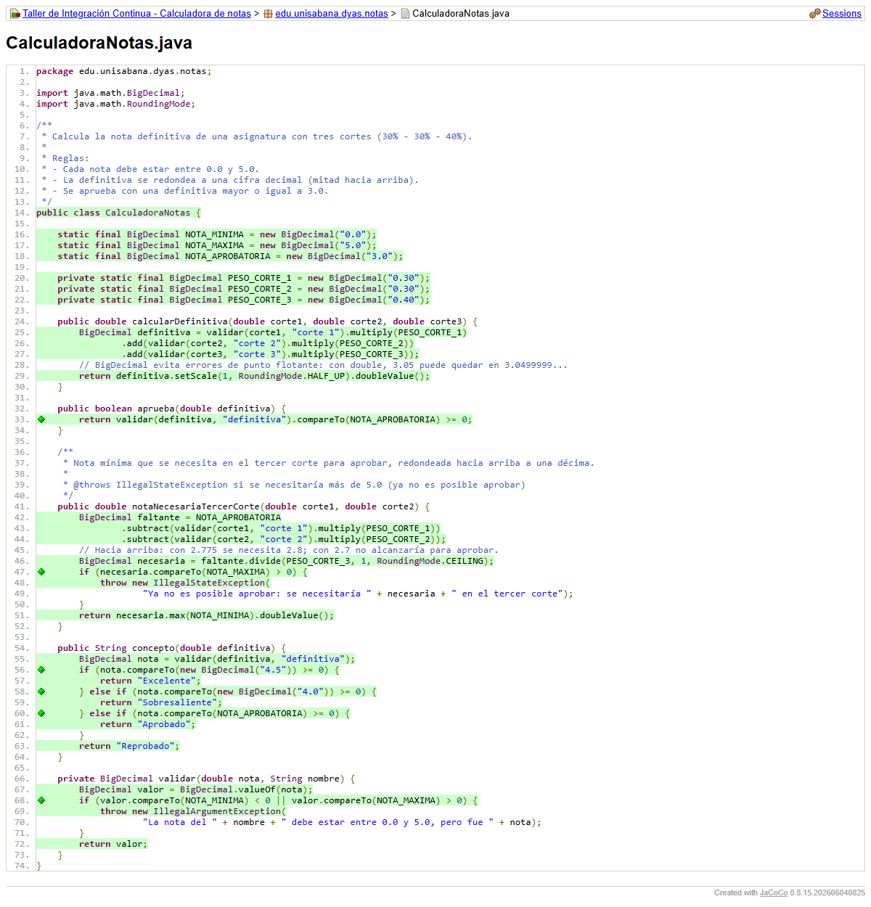

# Cobertura (JaCoCo)

El reporte HTML es el mismo que publica el pipeline en el artefacto **`reportes`** (`target/site/jacoco/index.html`).
Los dos reportes completos están en el repositorio: `entregables/reportes/jacoco-rojo-paso4/` y
`entregables/reportes/jacoco-verde/` (abrir `index.html`).

## Antes: commit `4833d32` (rojo por cobertura)

| Contador | Cubierto | Total | % |
|---|---|---|---|
| Instrucciones | 130 | 161 | 80,7 % |
| Ramas | 8 | 14 | 57 % |
| **Líneas** | **23** | **31** | **74 %** ← el umbral es sobre este contador |
| Métodos | 6 | 7 | 86 % |

Detalle del código: las líneas de `concepto(...)` en **rojo** (nunca ejecutadas) y sus tres `if` con el rombo rojo
(ninguna rama recorrida):

> Observación: la cobertura de **instrucciones** era 80,7 % (130/161), por encima del umbral, y aun así el build falló, porque la regla del
> `pom.xml` mide **líneas** (`<counter>LINE</counter>`). El contador elegido cambia el resultado.

## Después: commit `32b25d8` (verde)

| Contador | Cubierto | Total | % |
|---|---|---|---|
| Instrucciones | 161 | 161 | 100 % |
| Ramas | 14 | 14 | 100 % |
| **Líneas** | **31** | **31** | **100 %** |
| Métodos | 7 | 7 | 100 % |

## Por qué las pruebas de `concepto` son significativas (y no solo "cobertura")

Llegar al 80 % bastaba con **una** llamada a `concepto(4.0)` sin `assert`. En cambio `ConceptoTest`:

- Verifica el **valor devuelto** con `assertEquals` en cada caso.
- Prueba **ambos lados de cada frontera** (4.5/4.4, 4.0/3.9, 3.0/2.9): si alguien cambia un `>=` por `>`, una prueba
  falla. Con valores "del medio" (4.7, 4.2, 3.5, 1.0) se tendría la misma cobertura pero ese error pasaría inadvertido.
- Prueba los valores **fuera de rango** (−0.1 y 5.1), que deben lanzar `IllegalArgumentException`.
