# Evidencias de las ejecuciones

Cada evidencia corresponde a un commit del historial y a la salida de `mvn -B clean verify`, que es **el mismo comando**
que ejecuta el paso *"Compilar, probar y verificar cobertura"* del pipeline. Los logs completos están en
`entregables/evidencias/logs/` del repositorio.

> Las ejecuciones de estos mismos commits en **GitHub Actions** están en la sección
> [Ejecuciones en GitHub Actions](#ejecuciones-en-github-actions): dieron exactamente el mismo resultado.

---

## Paso 2 — Primer pipeline en verde 🟢

Commit `e96e674` *Primer pipeline: agrega integrantes del equipo* (agrega `integrantes.txt`).

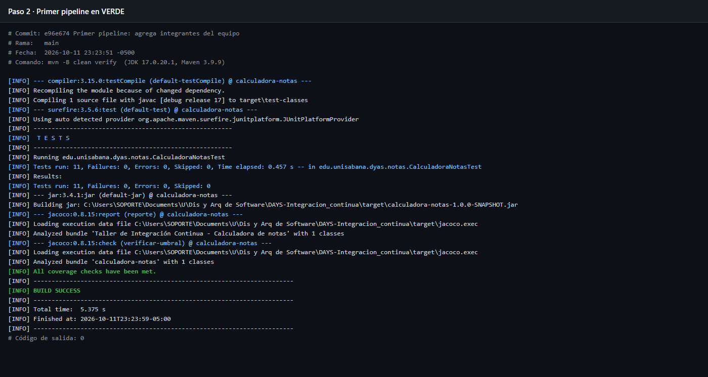

- `Tests run: 11, Failures: 0, Errors: 0, Skipped: 0`
- `All coverage checks have been met.`
- `BUILD SUCCESS`

Es la línea base: el código del taller compila, sus 11 pruebas pasan y la cobertura supera el 80 %.

---

## Paso 3 — TDD en el pipeline

Requisito: *"Como estudiante, quiero saber qué nota necesito en el tercer corte para aprobar"*.

### Red: rojo por compilación 🔴

Commit `e8f63ca`: **solo** se agrega `NotaNecesariaTest.java`, sin tocar `CalculadoraNotas`.

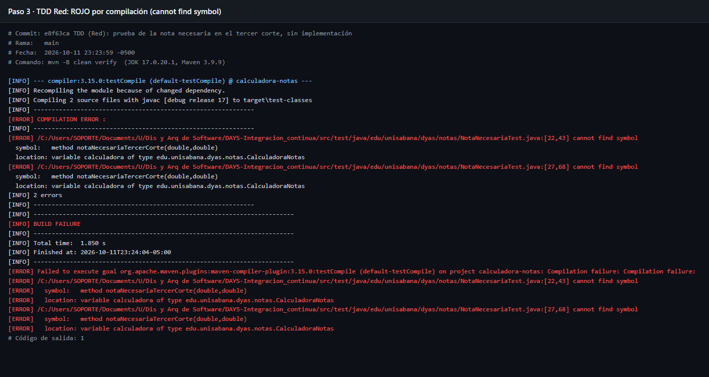

```text
[ERROR] .../NotaNecesariaTest.java:[22,43] cannot find symbol
  symbol:   method notaNecesariaTercerCorte(double,double)
  location: variable calculadora of type edu.unisabana.dyas.notas.CalculadoraNotas
[INFO] BUILD FAILURE
```

**Análisis:** el build se detiene en `testCompile`. No se ejecuta **ninguna** prueba (tampoco las 11 que ya existían), no
se genera `jacoco.exec` y por lo tanto el paso *Resumen de cobertura* del pipeline escribe *"No se generó reporte de
cobertura"*. El build tardó 2.1 s frente a ~6 s de un build completo: falló antes de llegar a las pruebas.

### Red (variante): rojo por pruebas fallidas 🔴

Commit `15c0464`: se agrega el método con cuerpo vacío (`return 0;`).

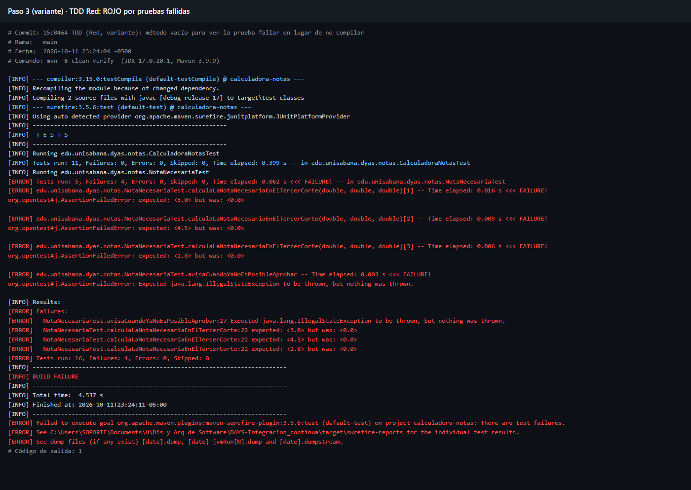

```text
[ERROR] Tests run: 5, Failures: 4, Errors: 0, Skipped: 0 <<< FAILURE! -- in edu.unisabana.dyas.notas.NotaNecesariaTest
[ERROR]   NotaNecesariaTest.calculaLaNotaNecesariaEnElTercerCorte:22 expected: <3.0> but was: <0.0>
[ERROR]   NotaNecesariaTest.calculaLaNotaNecesariaEnElTercerCorte:22 expected: <4.5> but was: <0.0>
[ERROR]   NotaNecesariaTest.calculaLaNotaNecesariaEnElTercerCorte:22 expected: <2.8> but was: <0.0>
[ERROR]   NotaNecesariaTest.avisaCuandoYaNoEsPosibleAprobar:27 Expected java.lang.IllegalStateException to be thrown, but nothing was thrown.
[ERROR] Tests run: 16, Failures: 4, Errors: 0, Skipped: 0
[INFO] BUILD FAILURE
```

**Análisis (comparación con el log anterior):** ahora el código **compila** y las 16 pruebas **sí se ejecutan**; Surefire
reporta exactamente cuáles fallan y con qué valores (*expected* vs *was*). Este log es mucho más útil: dice *qué* está
mal, no solo que el código no compila. Curiosamente, el caso `5.0, 5.0 -> 0.0` **pasa** con `return 0;`: una sola prueba
en verde no demuestra que la implementación sea correcta; por eso el requisito se prueba con varios casos.

### Green: verde con la implementación 🟢

Commit `29c1177`: se implementa `notaNecesariaTercerCorte` con `BigDecimal`, dividiendo entre 0.40 con
`RoundingMode.CEILING` (redondeo **hacia arriba** a una décima), lanzando `IllegalStateException` si se necesita más
de 5.0 y devolviendo como mínimo 0.0. Las notas de entrada se validan con el mismo `validar(...)` de `calcularDefinitiva`.

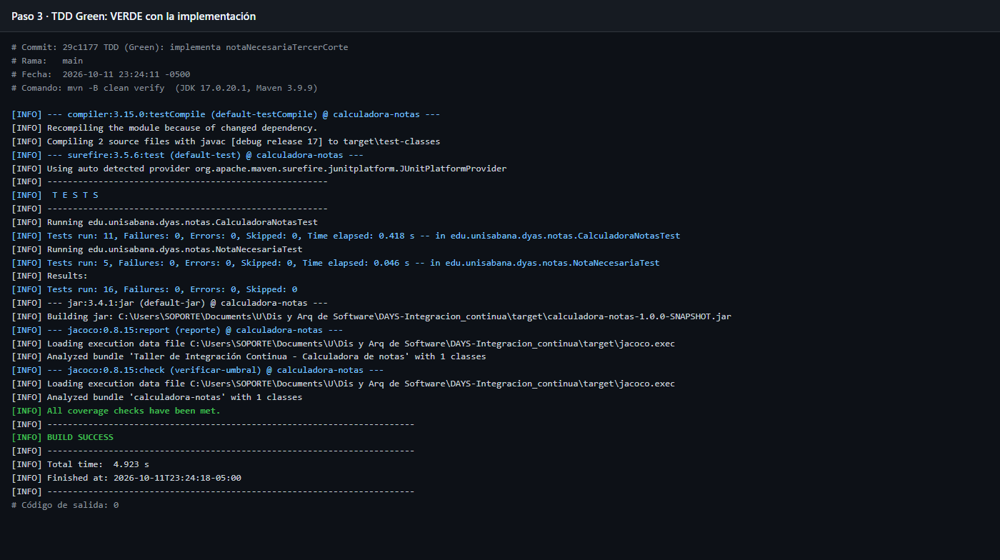

- `Tests run: 16, Failures: 0` · `All coverage checks have been met.` · `BUILD SUCCESS`

Ejemplo del redondeo: con 3.5 y 2.8 se necesitan (3.0 − 1.05 − 0.84) / 0.4 = **2.775** → **2.8**. Si se redondeara a la
mitad (2.8) daría lo mismo, pero con 2.7 el estudiante **no** aprobaría; por eso el requisito pide redondear hacia arriba.

---

## Paso 4 — Rojo por cobertura

### Rojo 🔴

Commit `4833d32`: se agrega `concepto(double)` **sin pruebas**.

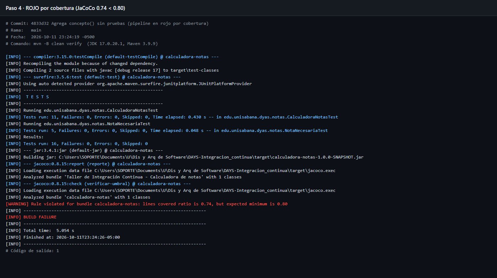

```text
[INFO] Tests run: 16, Failures: 0, Errors: 0, Skipped: 0
[WARNING] Rule violated for bundle calculadora-notas: lines covered ratio is 0.74, but expected minimum is 0.80
[INFO] BUILD FAILURE
[ERROR] Failed to execute goal org.jacoco:jacoco-maven-plugin:0.8.15:check (verificar-umbral) on project calculadora-notas: Coverage checks have not been met.
```

**Análisis:** **todas las pruebas pasan** y aun así el build falla, en la última meta (`jacoco:check`). Las 8 líneas de
`concepto` nunca se ejecutaron: 23 de 31 líneas cubiertas = **0.74**. Ver detalle en [Cobertura](Cobertura).

### Verde 🟢

Commit `32b25d8`: nueva clase `ConceptoTest` con 10 casos que prueban **los dos lados de cada frontera**
(5.0, 4.5 | 4.4, 4.0 | 3.9, 3.0 | 2.9, 0.0) y los valores fuera de rango (−0.1 y 5.1 → `IllegalArgumentException`).

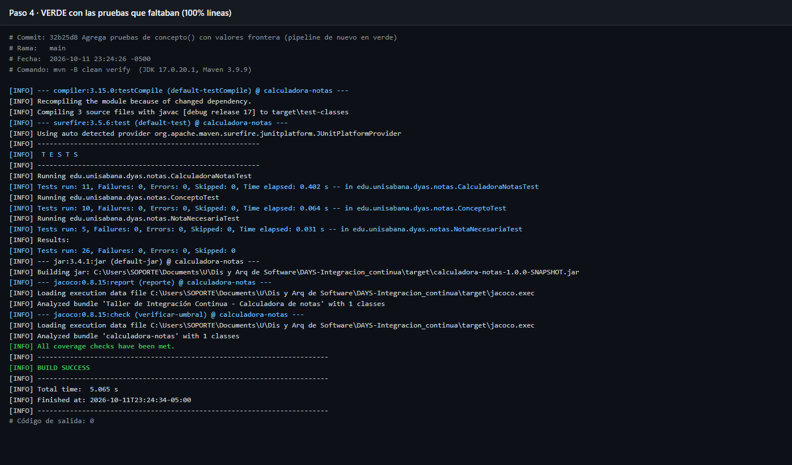

- `Tests run: 26, Failures: 0` · `All coverage checks have been met.` · `BUILD SUCCESS` · cobertura de líneas **100 %**.

---

## Paso 5 — Pull Request con el pipeline en rojo 🔴

Rama `prueba-rama-protegida`, commit `7c16737`: se cambia a propósito el resultado esperado de `5.0, 5.0, 5.0` a `4.9`.

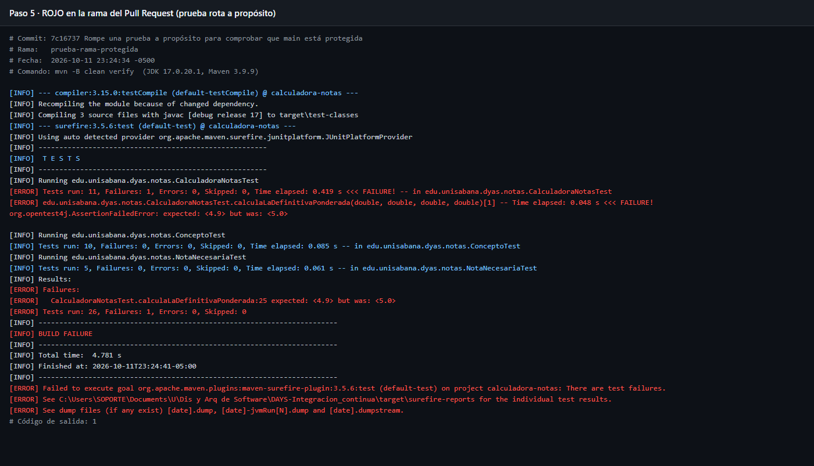

```text
[ERROR]   CalculadoraNotasTest.calculaLaDefinitivaPonderada:25 expected: <4.9> but was: <5.0>
[ERROR] Tests run: 26, Failures: 1, Errors: 0, Skipped: 0
[INFO] BUILD FAILURE
```

El PR de esta rama hacia `main` queda bloqueado por el ruleset. Ver [Rama protegida](Rama-protegida).

---

## Ejecuciones en GitHub Actions

Cada commit se subió por separado a `main` del fork, así que la pestaña
[Actions](https://github.com/EthianWhor/DAYS-Integracion_continua/actions) muestra una ejecución por paso, con el mismo
resultado que los logs locales: verde → rojo (compilación) → rojo (pruebas) → verde → rojo (cobertura) → verde.

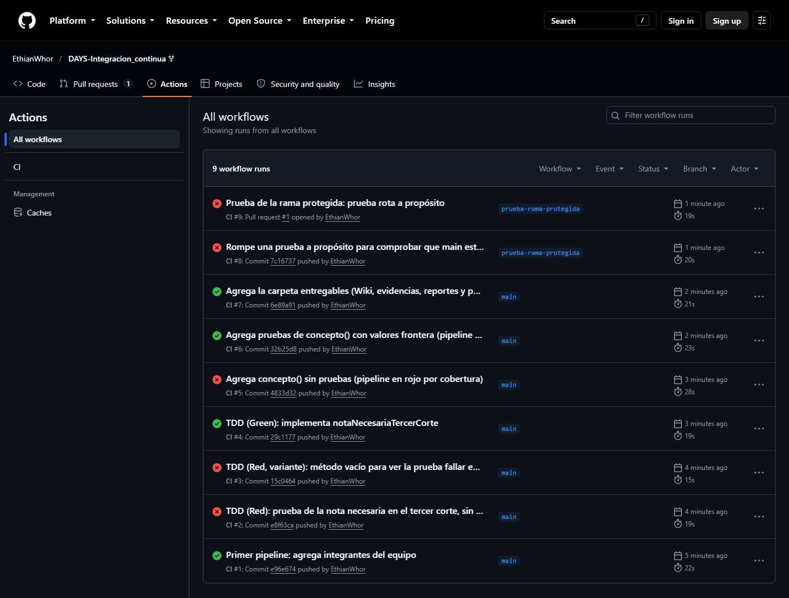

| Ejecución | Commit | Resultado |
|---|---|---|
| [CI #1](https://github.com/EthianWhor/DAYS-Integracion_continua/actions/runs/38200167987) | `e96e674` | 🟢 |
| [CI #2](https://github.com/EthianWhor/DAYS-Integracion_continua/actions/runs/38200201024) | `e8f63ca` | 🔴 compilación |
| [CI #3](https://github.com/EthianWhor/DAYS-Integracion_continua/actions/runs/38200226468) | `15c0464` | 🔴 `Tests run: 16, Failures: 4` |
| [CI #4](https://github.com/EthianWhor/DAYS-Integracion_continua/actions/runs/38200264537) | `29c1177` | 🟢 |
| [CI #5](https://github.com/EthianWhor/DAYS-Integracion_continua/actions/runs/38200308163) | `4833d32` | 🔴 cobertura 0.74 |
| [CI #6](https://github.com/EthianWhor/DAYS-Integracion_continua/actions/runs/38200334070) | `32b25d8` | 🟢 |
| [CI #9](https://github.com/EthianWhor/DAYS-Integracion_continua/actions/runs/38200397687) | `7c16737` (PR #1) | 🔴 `Tests run: 26, Failures: 1` |

Resumen de una ejecución en verde con el artefacto **`reportes`** (51.2 KB) publicado:

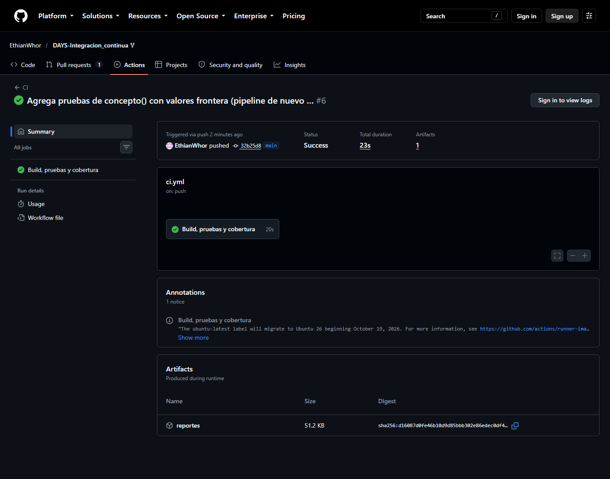

Log del runner de GitHub (Ubuntu) para el **rojo por compilación** — mismo `cannot find symbol` que en local:

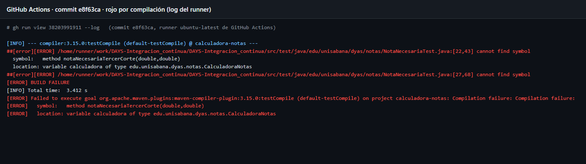

Log del runner para el **rojo por cobertura** — mismo `lines covered ratio is 0.74`:

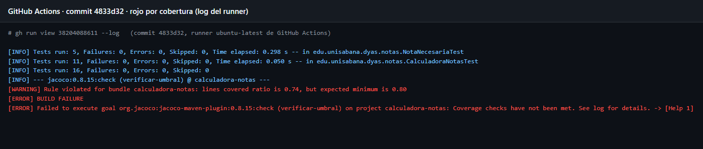
