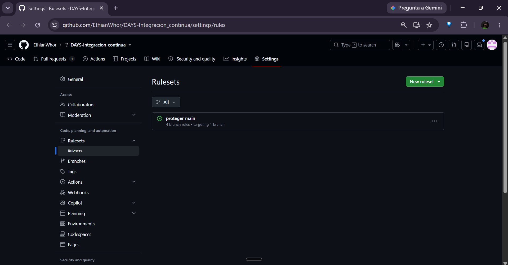
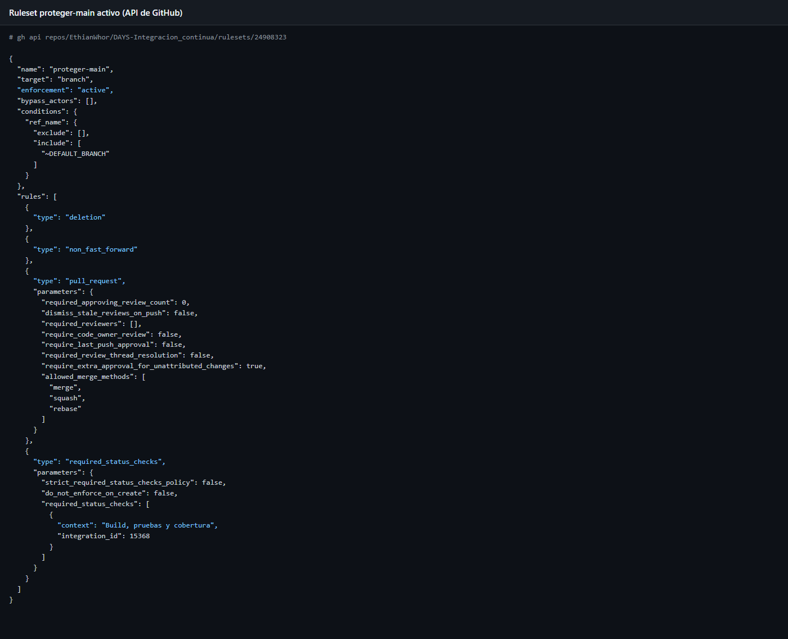
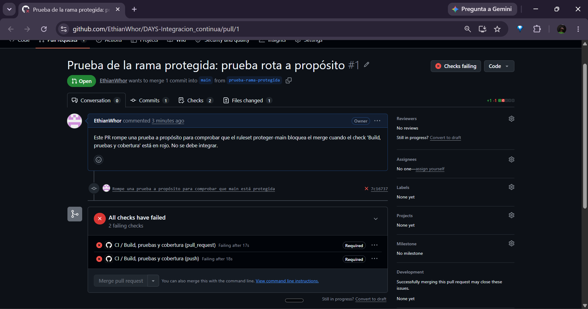
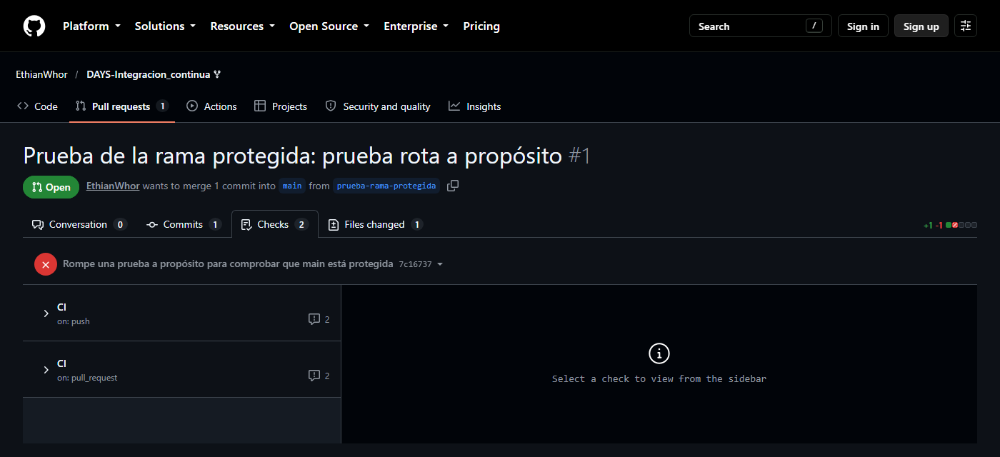
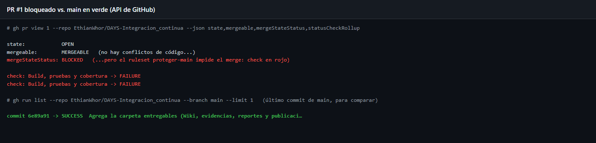

# Rama protegida (`main`)

## Ruleset `proteger-main`

Configuración (**Settings → Rules → Rulesets → New branch ruleset**), también disponible como JSON importable en
`entregables/github/ruleset-proteger-main.json` (**Settings → Rules → Rulesets → New ruleset → Import a ruleset**):

| Campo | Valor |
|---|---|
| Ruleset name | `proteger-main` |
| Enforcement status | **Active** |
| Target branches | **Include default branch** (`main`) |
| Require a pull request before merging | ✅ (aprobaciones requeridas: 0 en el taller; 1 en el proyecto, ver nota) |
| Require status checks to pass | ✅ check **`Build, pruebas y cobertura`** (fuente: GitHub Actions) |
| Block force pushes | ✅ (valor por defecto) |

> El check solo aparece en el buscador si el pipeline ya corrió al menos una vez en el repositorio; por eso el ruleset
> se crea **después** de subir los commits de los pasos 2 a 4.

> **Nota sobre aprobaciones:** en el Proyecto 3 se exige que **otro integrante** apruebe el PR
> (`required_approving_review_count: 1`). En este taller se dejó en 0 porque GitHub no permite aprobar un PR propio y
> con un único integrante el PR nunca podría integrarse.

Ruleset creado en el fork (consulta a la API de GitHub): `enforcement: active`, sin `bypass_actors` (ni siquiera el
dueño del repositorio puede saltárselo), PR obligatorio y check `Build, pruebas y cobertura` de GitHub Actions
(`integration_id: 15368`).

En **Settings → Rules → Rulesets** del fork, el ruleset aparece activo (ícono verde) con 4 reglas sobre 1 rama:



Detalle de sus reglas según la API:



## Prueba del bloqueo — [PR #1](https://github.com/EthianWhor/DAYS-Integracion_continua/pull/1)

1. Rama `prueba-rama-protegida` con el commit `7c16737`, que cambia el resultado esperado de `5.0, 5.0, 5.0` a `4.9`.
2. Pull Request `prueba-rama-protegida → main` (PR #1).
3. El pipeline corre dos veces (evento `push` de la rama y evento `pull_request`) y **ambas fallan**:

Vista del PR con la sesión del dueño del repositorio: GitHub lo marca con **Checks failing** y el commit `7c16737` con ❌.


En el cuadro de merge del PR: **All checks have failed**, y los dos checks `CI / Build, pruebas y cobertura`
(`pull_request` y `push`) aparecen marcados como **Required**, es decir, exigidos por el ruleset `proteger-main`.
Mientras estén en rojo, el PR no se puede integrar.





```text
[ERROR]   CalculadoraNotasTest.calculaLaDefinitivaPonderada:25 expected: <4.9> but was: <5.0>
[ERROR] Tests run: 26, Failures: 1, Errors: 0, Skipped: 0
[INFO] BUILD FAILURE
```

4. GitHub marca el PR como **`BLOCKED`**: no tiene conflictos (`MERGEABLE`), pero el ruleset impide integrarlo porque el
   check requerido está en rojo; el botón **Merge pull request** queda deshabilitado. El PR se deja abierto como evidencia.

Comparación con el [PR #2](https://github.com/EthianWhor/DAYS-Integracion_continua/pull/2) (actualización de
`integrantes.txt`), que siguió el flujo correcto: rama → PR → check en verde → merge.



Log del mismo fallo reproducido localmente:


## Conclusión

Desde que se activó el ruleset, **ningún cambio** puede llegar a `main` sin Pull Request y sin el pipeline en verde: el
PR #2 tuvo que pasar por ese flujo, y el PR #1, con una prueba rota, quedó bloqueado.
